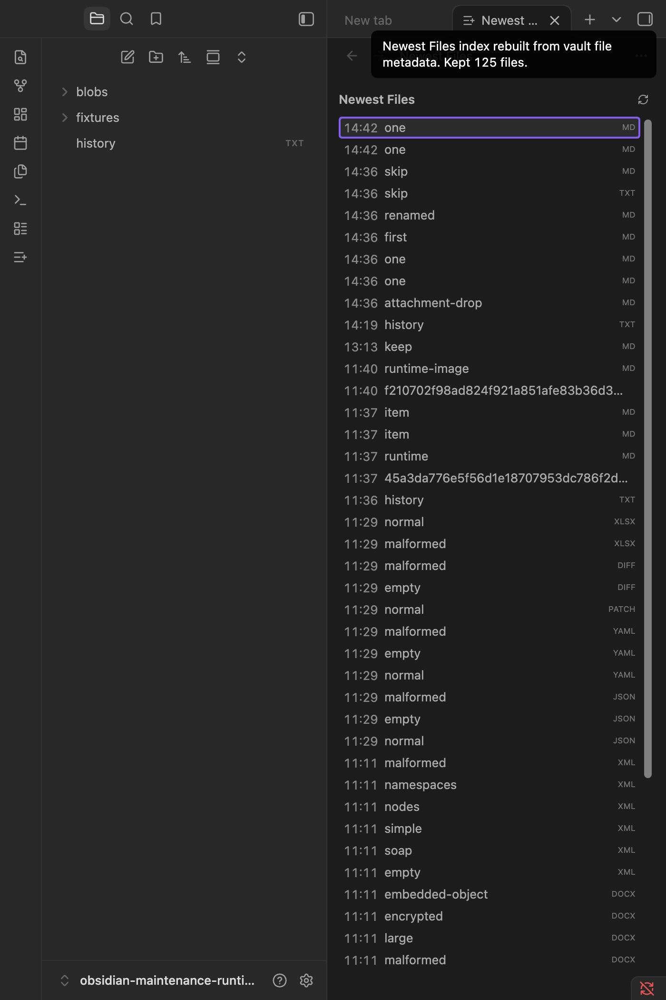
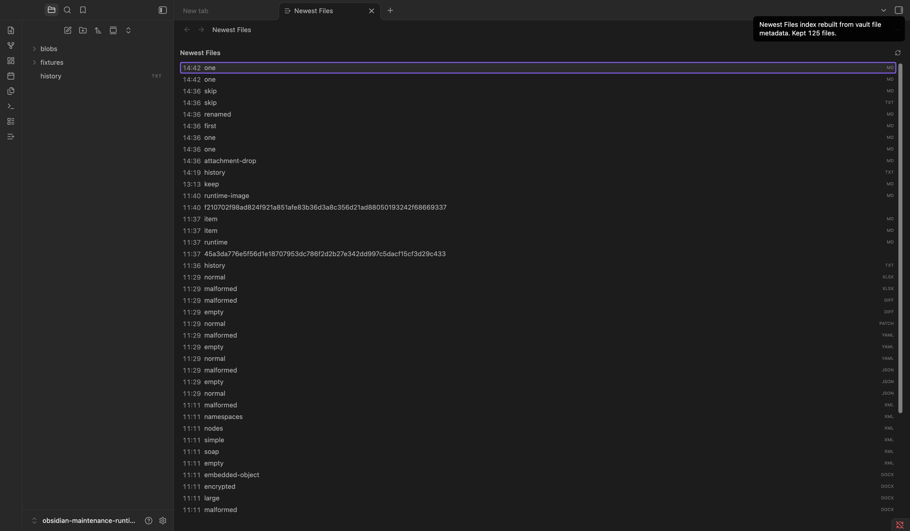
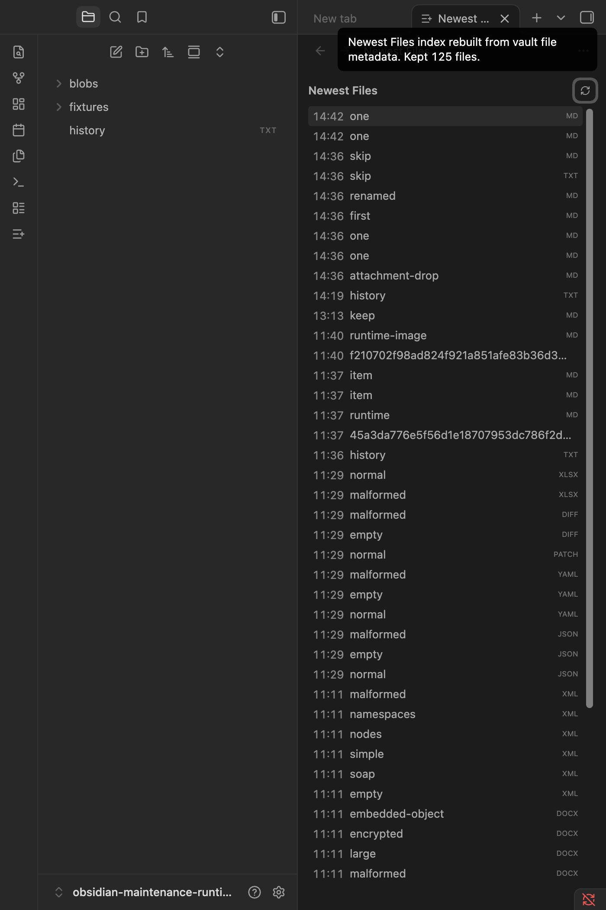
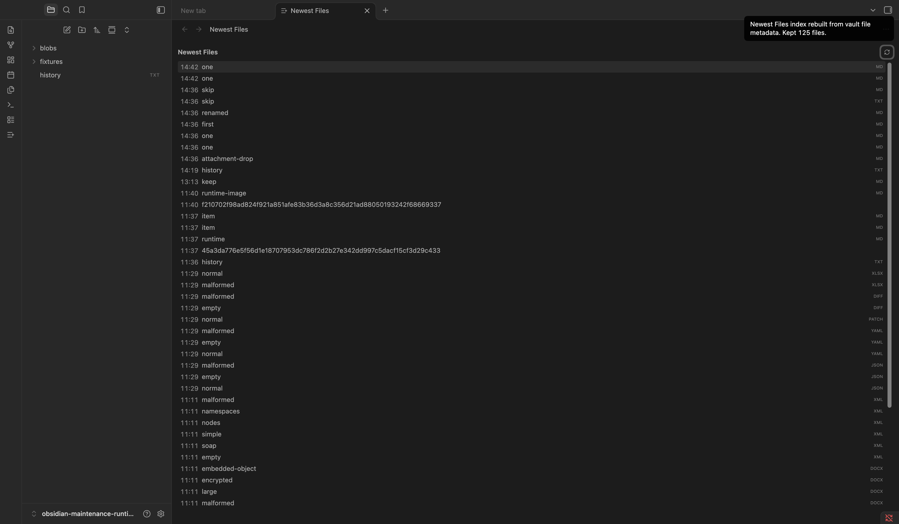

# Obsidian 1.15.1 verification — 16 November 2026

Maintenance patch `0.1.6` restores the visible keyboard focus indicator. The earlier functional host run exercised candidate `85719eb95fcaafe6f992ddc9a5e8897baf5bc1c1`; final CSS candidate `f90c9c4e8ceac5e03b60f6fd9ebc1aea85d35552` preserves its TypeScript, production bundle and manifest and was separately tested with exact source/main/manifest/CSS pins. Production main.js SHA-256: `236df5816931d967a923dd17a5e0e5ba7189093fdba8a2cee7fe237c451e13fb`.

## Exercised behavior

- actual create/modify/rename/delete events update index and modified ordering
- extension/path filters and rebuild exclude unwanted/config files
- timestamp setting rerenders and file button opens correct authored note; source bytes match intended test content
- default test settings/index restored and all three timers removed on unload

## Environment and validation

The final CSS was exercised at emulated application viewports of 700×1050 and 1800×1050. DOM focus positioned the preceding refresh control, then actual CDP Tab events targeted only the verified own renderer. The first file row became the active element with `:focus-visible` and a solid 2px inset outline. A temporary old-style `outline:none` negative control removed both outline and box-shadow focus indicators. Restoring the final CSS and reloading retained keyboard focus visibility. Renderer-targeted pointer movement separately changed the hovered row background without row keyboard focus. Default settings/index were restored through plugin methods and compared in memory and saved JSON. Existing public command IDs are retained for hotkey compatibility; existing Community command-ID/style warnings are recorded rather than hidden.

Tests use fictional fixtures in a fresh own synthetic vault on macOS arm64, the actual Obsidian 1.15.1 renderer and Electron 39.8.3. A bounded own bootstrap separates the CLI socket and test profile. Mock keychain is enabled; the regular application/CLI and installed original bytes are checked separately. Own test windows may be visible and remain unfocused. No OS mouse or keyboard input is used. The renderer uses an emulated 1800×1050 viewport; no native window geometry/throttle commands are used.

Ordinary locked `npm ci`, TypeScript checking, production build, existing test scripts and production dependency audit passed. Checked-in official `eslint-plugin-obsidianmd` 0.6.0 recommended checks cover source and metadata; existing repository lint guards are retained where present. Generated/test harness artifacts are outside the official production-source lint scope. Development tooling is not shipped.

## Scope limits

Default test settings/index are restored and compared in memory and saved JSON; generated synthetic data remains as evidence. Create/modify/rename/delete test operations affect only newly authored synthetic fixtures.

This establishes the exercised 1.15.1 macOS behavior and renderer keyboard/hover response. It does not establish OS accessibility/native keyboard integration, mobile, minimum-version, native-resize, pane/container behavior, authentication or real keychain behavior. Official Community source/release review, public asset readback and fresh catalog installation remain separate publication gates; a local build or screenshot alone does not establish them.

## Render evidence

The following captures intentionally preserve the temporary index-rebuilt notice. It overlays the application header, not the tested file rows or their focus/hover indicators.

